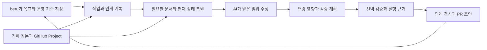

# GGB AI 작업과 검증 운영 기획

GGB의 첫 구축 목표는 **AI가 이전 작업을 이어받는 데 필요한 설명을 줄이고, 변경한 시스템에 필요한 검증만 실행하도록 만드는 것**이다. 이를 위해 짧은 저장소 안내, 작업별 인계 기록, 변경 영향에 따른 테스트 선택, 실행 근거 보관을 연결한다. 이후 같은 체계를 여러 AI와 이슈 기반 개발 자동화로 확장한다.

기준일은 2026년 10월 7일 KST다. 이 문서는 구축 기획이며 실행 도구와 새 운영 규칙은 아직 적용하지 않았다. 세부 실행 계약은 [하네스 구축 명세](ggb_harness_spec.md)에 있다.

## 사용자 요구와 적용 범위

| 항목 | 이번 대화에서 확인한 요구 |
| --- | --- |
| 가장 큰 불편 | AI에 맥락을 반복 설명하고 이전 작업을 이어가는 일 |
| 추가 불편 | 시스템이 바뀔 때마다 전체 테스트를 실행하는 비효율 |
| 반복 사례와 비용 | 수첩 검색의 철자 입력 방식 일부 변경에도 스크립트 및 챕터별 이벤트 기록을 재검사. 사용자가 보고한 소요 시간은 20~90분이며 수정할 때마다 반복 |
| 초기 사용자 | beru와 Codex |
| 확장 방향 | 여러 AI 에이전트 운용 후 팀 전체로 확대 |
| 개발 자동화 | 단계적으로 이슈 선택부터 수정, 검증, PR 작성까지 확대 |
| 운영 방식 | 문서와 표준 절차로 단순하게 운영하면서 사용자의 개입을 크게 유지 |
| 전체 회귀 주기 | 개발 중에는 영향 검증, 통합과 마일스톤에는 전체 검사 |
| 이번 결과물 | 현황 진단, 권장 구조, 단계별 구축 범위, 검증 정책, 인수 기준 |

**개발 중에는 영향 검증, 통합 후보와 마일스톤에는 전체 회귀**를 사용자가 선택한 기본 주기로 반영한다. 20~90분은 사용자가 보고한 현재 비용이며 직접 계측한 실행 시간은 아니다. suite별 소요 시간을 구축 전 계측해 절감 목표를 확정한다.

## 현재 구조와 문제

GGB는 기획과 Godot 구현을 함께 관리한다. 현행 제품 규칙은 `ideas/md/v04/`와 지정된 `docs/` 계약, 실행 구현은 `game/`에 있다. GitHub Issue와 Project가 작업과 상태의 기준이며, Discord와 대시보드는 이를 전달한다. 기존 [프로젝트 운영 기준](project_operations.md)과 [GitHub 운영 기준](github_project.md)을 유지해 연결한다.

2026년 10월 7일 조사에서 다음을 확인했다. 수량은 조사 시점의 스냅샷이며 운영 중에는 자동 집계한다.

| 관찰 | 영향 | 구축에 반영할 조치 |
| --- | --- | --- |
| 추적 Markdown 414개, 테스트 디렉터리의 GDScript 83개 | 매번 전체를 읽거나 파일 수를 테스트 수로 해석하기 어려움 | 작업별 읽기 경로와 실행 가능한 테스트 목록 제공 |
| 저장소에서 추적하는 `AGENTS.md`가 없음 | 새 대화의 시작 규칙과 인계 경로가 일정하지 않음 | 짧은 루트 안내와 필요한 문서로 가는 경로 추가 |
| [검증 계획](validation_plan.md)은 V1 이후를 미구현으로 표시하지만 [전편 구현 현황](full_game_implementation_status.md)과 후속 검증 기록에는 실제 실행 근거가 있음 | 과거 기준선과 최신 실행 상태를 혼동할 수 있음 | 현재 상태, 과거 기록, 미충족 제품 조건을 구분해 안내 |
| [기반 검증 실행기](../scripts/run_godot_foundation.ps1)는 34개 고유 smoke 인자를 순차 호출 | 국소 작업에도 넓은 검증이 붙기 쉬움 | 실행기보다 먼저 테스트 목록과 선택 규칙 분리 |
| [수첩 조회 검사](../game/scripts/tests/notebook_query_smoke.gd)가 내부에서 13개 하위 smoke 파일을 호출 | 상위와 하위 검사를 따로 고르면 중복 실행 | 포함 관계와 실행 조건을 목록에 기록 |
| 기반 실행기는 고정된 임시 실행 경로를 사용 | 여러 AI의 동시 실행이 서로의 복사본에 영향을 줄 수 있음 | 실행별 경로와 사용자 데이터 격리 |
| [수첩 실행 감사](../scripts/run_notebook_runtime_audit.ps1)는 로그 해시와 실행 receipt를 이미 생성 | 증거 형식을 새로 만들 필요가 줄어듦 | 기존 증거 형식을 공통 결과와 연결 |
| 현재 CI 문서 검증 workflow는 V0를 실행 | 로컬 Godot 테스트 존재와 CI 보장 범위가 다름 | 로컬 실행 가능 여부와 CI 적용 여부를 각각 표시 |
| 작업 트리에 기존 수정과 미추적 에셋 및 플러그인이 있고 조사 중 HEAD도 변경됨 | 커밋 번호만으로 실제 검사 입력이나 수정 소유자를 설명할 수 없음 | 작업 시작 상태와 실제 입력 스냅샷을 기록 |

83개 파일에는 fixture와 helper도 포함된다. 34개 실행 인자도 제품 전체 검증을 뜻하지 않는다. 실제 실행 단위와 검사 범위는 별도 목록으로 확정한다.

제품 엔진 요구는 현재 문서와 bootstrap에서 4.7 계열이다. 4.6.3 후보의 IME와 debug EXE 검사 근거는 있지만 [엔진 채택과 넓은 인수 조건](../ideas/md/v04/issues/validation/2026-10-07_엔진템플릿_버전일치_및_EXE검증.md)은 남아 있다. 하네스 구축 과정에서 후보 엔진을 제품 기준으로 자동 승격하지 않는다. 통합 수첩도 [현행 TODO](../ideas/md/v04/issues/validation/notebook_history_TODO.md)의 rollout OFF와 미완료 인수 범위를 이어받는다.

## 권장 운영 구조

**짧은 문서 안내와 얇은 로컬 실행기를 먼저 구축한다.** 현재 PowerShell 도구와 Godot smoke를 재사용하고, 처음에는 새 서비스나 별도 에이전트 서버를 추가하지 않는다. 기존 Codex 대화에서 도구를 실행하고 인계 자료를 읽는 흐름으로 시작한다.

| 구성 | 맡는 일 | 규모 제한 |
| --- | --- | --- |
| 루트 `AGENTS.md` | 정본 위치, 시작과 종료 절차, 선택 검증 원칙 안내 | 처음에는 약 60행 이내를 목표로 작성 |
| 프로젝트 맥락 요약 | 현재 개발 단계, 공통 제약, 열린 주요 문제의 출처 안내 | 현재 정보만 남기고 과거 상세는 링크 |
| 시스템 목록 | 시스템별 코드, 계약, 의존성, 검증과 담당 연결 | 코드 전체를 설명하는 문서를 만들지 않음 |
| 작업 기록 | 목표, 사용자 결정, 수정 범위, 남은 일, 재개 순서 | 작업 하나에 계약 하나 |
| 로컬 실행기 | 환경 확인, 맥락 출력, 테스트 선택과 실행, 인계 생성 | PowerShell 7과 JSON을 기본으로 검토 |
| 실행 근거 | 검사 입력, 명령, 환경, 결과, 로그와 재사용 여부 | 원자료와 사람이 읽는 요약을 함께 보관 |

초기 버전에서 모든 기존 문서를 개편하지 않는다. 진입점 문서의 현재 상태를 바로잡고, 자주 사용하는 시스템부터 연결한다. 팀 확대 시 제작 의뢰와 에셋 접수도 같은 작업 기록에 연결한다.

## AI가 작업을 이어받는 방법

### 시작할 때

사용자는 목표와 작업 식별자만 전달할 수 있어야 한다. 예를 들어 “수첩 검색 개선 작업 이어서 진행해”라고 하면 AI가 연결된 작업 기록, 최신 실행 결과, 수정 전후 차이와 관련 계약을 먼저 복원한다.

1. 작업 기록의 목표와 마지막 사용자 결정을 읽는다.
2. 현재 branch, HEAD, 기존 수정, 다른 작업의 진행 흔적을 확인한다.
3. 관련 시스템의 필수 문서와 변경 파일만 읽고 부족한 내용을 추가 탐색한다.
4. 완료된 일, 남은 일, 검증이 유효한 범위를 간단히 확인한 뒤 진행한다.

여러 활성 작업 중 어느 작업인지 식별되지 않을 때는 한 번의 선택 질문으로 해결한다. 최신 대화라는 이유로 임의의 작업을 이어받지 않는다.

### 작업 기록에 남길 내용

| 정보 | 기록 방식 |
| --- | --- |
| 목표와 완료 조건 | 사용자 의도와 관찰 가능한 결과 |
| 사용자 결정과 제약 | 선택한 안, 적용 범위, 변경된 이전 결정 |
| 연결된 정본 | 문서 경로와 절, 이슈와 결정 ID |
| 수정 범위 | 담당 파일, 공유 파일, 다른 작업의 기존 수정 |
| 확인한 사실 | 구현 결과와 검증 근거의 링크 |
| 미완료와 다음 행동 | 다음 실행 명령이나 수정 위치까지 적음 |
| 시행착오 | 다시 시도하지 않을 이유가 있는 접근만 보존 |
| 검증 상태 | 실행, 재사용, 실패, 미실행과 그 이유 |

대화 전문을 계속 복사하는 방식은 사용하지 않는다. 중요한 결정과 현재 상태를 남기고 상세 근거는 연결한다. 새 사용자 지시가 기존 작업 기록을 바꾸면 적용 범위와 대체된 내용을 갱신한다. 실행 로그나 외부 문서의 문장은 사용자 승인으로 취급하지 않는다.

### 종료와 중단 때

하나의 결과물이 끝났을 때, 담당 AI를 바꿀 때, 범위를 바꾸거나 차단이 발생했을 때 인계를 갱신한다. 매 작은 편집마다 기록을 늘리지는 않는다. 강제 중단 후에는 마지막 기록과 실제 diff 및 실행 receipt를 대조해 복원한다.

작업 종료의 최소 출력은 **무엇을 바꿨는지, 어떤 검사로 확인했는지, 무엇이 남았는지, 다음 행동이 무엇인지**다. 작업 계약과 실행 결과로 재개용 요약을 생성하고, AI의 설명이 필요한 판단만 사람이 읽는 인계에 추가한다.

Codex는 시작 시 `AGENTS.md`를 탐색하지만 세부 맥락 파일을 모두 자동으로 읽는 것은 아니다. 루트 안내에서 작업별 읽기 경로를 지정하고 실제로 읽도록 연결해야 한다. 또한 시작 위치에 따라 하위 안내의 적용이 달라질 수 있으므로 루트에서 시스템 목록을 명시적으로 안내한다. [공식 AGENTS.md 안내](https://learn.chatgpt.com/docs/agent-configuration/agents-md)

필수 문서 전체를 매번 읽게 하는 규칙은 넣지 않는다. 상황에 맞는 문서 안내와 짧은 지침은 OpenAI의 현재 권장 방향에도 부합한다. [공식 지침과 스킬 운영 안내](https://developers.openai.com/blog/rethinking-skills-and-prompts-for-gpt-6-astra)

## 변경에 맞춰 검증하는 방법

검증은 **빠른 공통 확인 → 변경 시스템 → 영향을 받는 연결 지점 → 필요한 통합** 순서로 선택한다. AI는 선택한 이유와 제외한 넓은 검증을 설명하고, 성공한 동일 검사를 이유 없이 다시 실행하지 않는다.

사용자가 제시한 철자 입력 변경에는 입력 이벤트, 조합과 확정, 검색 요청, 관련 UI와 조회 경로를 우선 검사한다. 기록 생성, 챕터 이벤트 또는 저장 계약이 바뀌지 않았다면 챕터별 기록 생산자 감사를 개발 반복의 필수 검사로 붙이지 않는다. 엔진 교체나 공통 입력 라우팅까지 바뀌면 그 영향에 맞춰 검증을 넓힌다.

| 시점과 변경 | 기본 검증 |
| --- | --- |
| 운영 문서나 단순 문구 수정 | 문서 및 관련 참조 검사 |
| 한 시스템의 구현 수정 | import 및 parse, 해당 시스템의 회귀, 연결 계약 검사 |
| 공통 UI 수정 | 관련 화면과 호스트, 포커스 및 복귀 검사, 필요한 실제 화면 확인 |
| 저장과 리셋 또는 상태 모델 수정 | 저장 및 복구, 영향을 받는 소비자, 필수 캠페인 경로 |
| 엔진이나 프로젝트 설정 및 공통 진입점 수정 | 넓은 런타임 회귀와 영향받는 export 및 입력 검사 |
| 통합 후보와 마일스톤 | 사전에 정의한 전체 자동 회귀와 해당 단계의 수동 인수 |
| 영향 범위가 분류되지 않는 변경 | 부족한 분류를 표시하고 시스템군 또는 전체 자동 회귀로 확대 |

**전체 자동 회귀와 제품 인수는 구분한다.** headless PASS가 실제 화면, 물리 IME 입력, 청취 품질, 성능 인수와 출시 완료를 대신하지 않는다. [현재 검증 계획](validation_plan.md)의 단계명은 유지하고, 자동 선택 프로필은 그 실행 범위를 조합한다.

통합 게이트는 여러 작업 결과를 묶어 실제 통합 브랜치에 반영할 후보를 확정한 시점으로 정의한다. 한 시스템의 중간 편집이나 AI가 부분 결과를 전달할 때마다 통합 게이트를 새로 만들지는 않는다. 이 게이트와 마일스톤에서는 정의된 전체 자동 회귀를 확인하되, 같은 입력과 조건에 유효한 결과는 재사용할 수 있다.

반복 실행을 줄이는 규칙은 다음과 같다.

- 상위 suite가 같은 조건의 하위 검사를 포함하면 해당 하위 검사를 또 실행하지 않는다.
- 처음에는 같은 입력 스냅샷 안에서 이미 완료한 검사만 재사용한다. 의존성 목록을 검증한 뒤 다른 스냅샷에서의 재사용을 추가한다.
- 실패를 고친 뒤에는 실패 검사와 수정 영향이 생긴 검사부터 다시 실행한다.
- 테스트 코드, fixture, 설정, 엔진 또는 필요한 의존성이 바뀌면 해당 결과를 무효화한다.
- 변경하지 않은 테스트를 생략한 이유와 전체 회귀를 미룬 시점을 결과에 남긴다.
- 공식 감사가 전체 소스 지문 일치를 요구하면 그 계약을 그대로 지킨다. [수첩 합집합 감사](../scripts/audit_notebook_runtime_union.ps1)의 과거 로그를 국소 변경만으로 새 소스의 증거로 승격하지 않는다.

소스 지문이 바뀌어 이전 전체 감사가 최신 근거가 아니게 되는 것과, 지금 전체 감사를 다시 실행해야 하는 것은 다른 판단이다. 일반 검색 수정에서는 기존 감사를 이전 입력의 이력으로 보존하고 최신 전체 감사가 필요한 통합 게이트에서 갱신한다. 작업 완료 조건 자체가 생산자 감사라면 그 요구에 맞춰 실행한다.

실행 중 수정한 프로젝트를 계속 읽으면 검사 시작과 끝의 코드가 달라질 수 있다. 검사 입력은 먼저 복사 또는 패키징해 고정하고, 결과를 그 입력에 연결한다. 현재 HEAD라는 설명만으로는 충분하지 않다.

## 여러 AI의 역할과 작업 분리

| 역할 | 책임 | 작업 경계 |
| --- | --- | --- |
| 조정 AI | 사용자 목표 해석, 작업 분해, 맥락 준비, 통합과 인계 | 우선순위나 제품 범위를 임의 변경하지 않음 |
| 구현 AI | 맡은 시스템의 수정과 관련 회귀 | 지정 파일과 완료 조건을 따름 |
| 검토 AI | 실제 변경과 완료 조건, 검증 선택의 누락 확인 | 초기에는 읽기와 의견 작성 중심 |
| 검증 AI | 고정 입력의 테스트 실행, 실패 분석과 근거 정리 | 제품 파일과 사용자 저장을 수정하지 않음 |

처음에는 조정 AI와 구현 AI를 같은 대화에서 운용하고, 독립 검토 또는 검증 하나를 붙인다. 여러 작성자가 같은 핵심 파일을 수정하는 병렬화는 이후에 도입한다. 모델이나 공급자는 작업 계약에 종속시키지 않는다.

병렬 구현은 작업별 worktree 또는 checkout과 수정 소유권을 사용한다. `save_manager.gd`, `game_state.gd`, `bootstrap.gd`, 공통 패널과 기획 정본처럼 여러 작업이 만나는 파일은 한 번에 한 작성자가 맡는다. 통합 담당자가 공유 변경을 반영하고 통합 스냅샷을 검사한다.

첫 실험에서는 구현 작업을 최대 2개로 제한한다. 병렬 수는 처리량과 충돌 및 검증 지연을 측정한 뒤 늘린다. 상세 절차는 [작업과 실행 명세](ggb_harness_spec.md)에 있다.

## 사용자 개입과 자동화의 경계

운영은 사용자가 목표와 우선순위를 정하고 AI가 정보를 정리하는 방식으로 둔다. 개발은 정해진 범위 안에서 반복 작업을 자동화한다. 이미 승인한 범위의 수정과 격리 검증에는 매번 같은 확인을 요구하지 않는다.

| 행동 | 향후 기본 방식 |
| --- | --- |
| 승인한 작업의 맥락 복원, 구현, 관련 검증과 인계 | AI가 연속 수행 |
| READY 이슈 후보 정리 | AI가 근거와 선행 관계를 제시 |
| 조건을 충족한 이슈 자동 선택 | 사용자가 허용한 목록과 우선순위 규칙 안에서 수행 |
| PR 작성 | 검증 근거와 미완료 조건을 붙여 draft로 제출 |
| 운영 우선순위, 일정, 담당 또는 범위 변경 | 사용자가 결정하고 AI가 반영 |
| 제품 엔진 채택, rollout과 공개 빌드 또는 출시 | 사용자의 명시적 결정과 해당 검증 조건에 따라 수행 |
| 팀 전달과 Discord 알림 | 정해진 승인 범위의 발송만 수행 |

GitHub Project의 상태와 일정이 정본인 원칙을 유지한다. 로컬 기록은 실행의 상세와 인계 정보를 소유한다. 외부 동기화가 실패하면 미반영으로 표시하고, 자동으로 성공 처리하거나 같은 이슈를 다시 만들지 않는다.

## 단계별 구축 계획

### 1단계 맥락과 상태 정리

짧은 루트 안내, 프로젝트 맥락, 우선 시스템 목록과 작업 인계 형식을 추가한다. [게임 README](../game/README.md), [검증 계획](validation_plan.md), [제작 백로그](production_backlog.md)의 현재 안내를 최신 근거와 연결하고 과거 내용은 이력으로 표시한다. 제품 전체 완료 판정은 별도 조건을 따른다.

최초 시범 작업은 **수첩 조회 또는 검색의 국소 변경 한 건**으로 한다. 이 작업은 사용자 불편과 직접 연결되고 기존 테스트의 포함 관계를 확인하기 좋다. 두 번째 시범은 [오디오 제작 의뢰](requests/audio/README.md)처럼 코드 수정과 다른 형태의 인계를 사용한다.

인수 조건은 새 대화의 AI가 이전 대화 전문 없이 목표, 사용자 결정, 현재 수정, 남은 일과 다음 행동을 설명하는 것이다. 시작 시간과 사용자의 재설명 횟수를 기록한다.

### 2단계 테스트 선택과 격리 실행

기존 83개 GDScript를 실행 가능한 suite, 포함된 검사, fixture와 helper로 분류한다. 우선 수첩 조회, 저장과 리셋, 챕터, UI, 운영 스크립트의 선택 규칙을 작성한다. 실행별 경로와 timeout, 결과 JSON을 붙인다.

같은 입력에서 완료한 실행 단위의 결과를 기록해 동일 검사를 다시 요구하면 재사용한다. 여러 시스템 변경이 한 작업에 모이면 해당 시스템 검증의 합집합을 한 번 실행한다.

처음에는 기존 전체 검증 정책을 유지하는 제한된 비교 실험으로 선택 누락을 확인한다. 예시 변경 5건과 실제 변경 최소 3건을 비교한 뒤, 영향 검증을 개발 기본값으로 전환한다. 전체 회귀를 매 편집마다 추가하는 방식으로 이 실험을 계속 운영하지 않는다.

인수 조건은 선택 이유를 볼 수 있고, 같은 하위 검사를 중복 실행하지 않으며, 두 실행의 파일과 사용자 데이터가 충돌하지 않는 것이다.

### 3단계 여러 AI와 결과 재사용

수정 소유권과 작업별 worktree, 인계 복원, 독립 검토를 연결한다. 의존성 정확도가 확인된 시스템에 한해 다른 스냅샷 사이의 결과 재사용을 추가한다.

인수 조건은 독립 작업 두 건을 통합하고, 의도적인 파일 충돌과 오래된 실행 근거를 탐지하며, 조정 AI를 교체해도 작업을 재개하는 것이다.

### 4단계 이슈부터 PR까지

사용자가 자동 처리할 수 있는 이슈 범위와 선행 조건을 정한다. 후보 조회, 작업 계약 생성, branch 또는 worktree 준비, 구현, 선택 검증, 검토, draft PR, 인계와 Project 반영을 연결한다.

최초 범위는 완료 조건이 명확한 작은 BUG 또는 DOCS 이슈다. 운영 우선순위 변경과 제품 결정은 후보 제안으로 남긴다. 팀 확대 시 제작자, 의뢰 ID와 에셋 승인 근거를 기존 대장에 연결한다.

인수 조건은 한 이슈가 중복 등록 없이 draft PR까지 진행하고, 사람이 결과와 검증 범위를 검토할 수 있는 것이다.

## 구현 백로그

아래 키는 기획 내 분해용이며 실제 `GGB-WRK` 발급이나 GitHub 등록을 뜻하지 않는다. 구축을 시작할 때 기존 [작업 템플릿](templates/work_item.md)과 중복 검색을 통해 실제 작업으로 연결한다.

| 키 | 우선순위 | 결과물 | 선행 | 완료 근거 |
| --- | --- | --- | --- | --- |
| OP01 | P1 | 현재 진입 문서와 검증 상태 정리 | 없음 | 과거 기준선과 현행 근거의 대조표 |
| OP02 | P1 | 루트 안내와 시스템별 맥락 경로 | OP01 | 새 AI의 필요한 문서 탐색 |
| OP03 | P1 | 작업 계약과 인계 생성 | OP02 | 두 종류 작업의 새 대화 재개 |
| OP04 | P1 | 테스트 목록과 포함 관계 | 없음 | CLI와 실제 runner의 대조, 미분류 표시 |
| OP05 | P1 | 변경 영향 선택과 이유 출력 | OP04 | 예시 5건 및 실제 3건 비교 |
| OP06 | P1 | 실행 격리와 공통 결과 | OP04 | 동시 실행과 timeout, 잘못된 PASS 거부 |
| OP07 | P2 | 의존성이 같은 다른 스냅샷의 결과 재사용 | OP05, OP06 | 입력과 환경 변경 시 무효화 |
| OP08 | P2 | 여러 AI의 소유권과 통합 절차 | OP03, OP06 | 독립 작업 2건과 충돌 시나리오 |
| OP09 | P2 | READY 후보부터 draft PR 연결 | OP05, OP08 | 허용 이슈 1건의 연속 처리 |
| OP10 | P3 | 팀 제작물 접수와 인계 연결 | OP03 | 기존 의뢰 및 에셋 대장 연동 |

우선 OP01~OP06으로 첫 버전을 만든다. 작업 계약 생성과 테스트 선택을 한 진입점에서 사용할 수 있으면 첫 구축을 종료하고 실제 작업으로 효용을 검증한다. GUI 대시보드와 별도 에이전트 서버는 반복 사용에서 필요성이 확인된 뒤 검토한다.

기획용 공수 범위는 1단계 2~4시간, 2단계 6~12시간, 3단계 4~8시간, 4단계 8~16시간이다. 이는 측정 전 비교용 추정이며 기존 suite 분리, 외부 인증과 엔진 확정 작업은 별도다. 달력 일정은 사용자의 투입 가능 시간과 첫 시범 결과로 정한다.

## 효과 측정과 구축 완료 기준

처음 3~5개 작업에서 기준선을 수집하고 다음 10개 작업을 비교한다. 테스트 시간에는 프로젝트 복사와 import, 선택 검사, 통합 회귀 시간을 모두 포함한다.

| 지표 | 측정 방법 | 첫 버전 목표 |
| --- | --- | --- |
| 재개 준비 시간 | 새 AI가 목표와 다음 행동을 확인하기까지 | 단순 재개 5분 이내 |
| 사용자 재설명 | 같은 사실과 결정을 다시 알려준 횟수 | 새 정보 이외의 재설명 감소 |
| 국소 검증 시간 | 비슷한 변경의 전체 검사 방식과 영향 검사 비교 | 중앙값 50% 절감을 시범 목표로 검토 |
| 중복 검사 | 같은 입력과 조건의 같은 실행 단위 반복 | 자동 선택 안에서 0건 |
| 검증 선택 누락 | 비교 실험과 이후 통합 회귀에서 발견 | 시범에서 0건, 발생 시 규칙 보완 |
| 근거의 정확성 | 변경 입력과 재사용 판정 및 로그 대조 | 오래된 근거를 새 PASS로 기록한 사례 0건 |
| 운영 기록 부담 | 작업 종료 시 기록에 든 시간 | 생성 요약 보정 중심으로 유지 |

목표 수치는 성과 예측이 아니다. 측정 후 사용자가 수용할 운영 비용과 절감 폭을 정한다. 선별 검증에서 놓친 결함이 통합 회귀에서 발견되면 영향 규칙을 보완하고 해당 시스템은 임시로 검증 범위를 넓힌다.

첫 버전은 다음 네 조건으로 완료한다.

- [ ] 이전 대화를 읽지 않은 AI가 작업 한 건을 정확히 재개한다.
- [ ] 국소 변경의 필요한 검사를 이유와 함께 고르고 중복 없이 실행한다.
- [ ] 같은 입력의 PASS를 재사용하고 변경된 입력의 PASS는 재사용하지 않는다.
- [ ] 사용자가 목표와 운영 판단을 유지하면서 완료 결과와 미완료 조건을 검토한다.

## 추가 확인 항목

| 입력 | 현재 기본안 | 계획에 미치는 영향 |
| --- | --- | --- |
| 반복하는 전체 검사 명령 | 철자 입력 변경에도 기록 및 이벤트 검사 반복, 20~90분이라는 사례 확보 | 실제 명령과 suite별 비용은 자동 계측 |
| 전체 회귀 주기 | 사용자가 통합 후보와 마일스톤을 선택 | 개발 및 PR 프로필과 실행 비용 |
| 초기 여러 AI의 종류와 동시 작성 수 | 공급자와 무관한 계약, 구현 최대 2개 | 어댑터와 통합 절차 |
| 구축에 쓸 수 있는 시간 | 1~2단계 우선 | 구축 일정과 초기 자동화 범위 |
| GitHub 자동 처리 허용 범위 | 작은 READY BUG 및 DOCS 후보부터 | 자동 선택 조건과 draft PR 연결 |

위 입력은 단계별 상세 설정에 반영한다. 파일 경로, 엔진과 템플릿, 권한 등 환경값은 향후 `doctor`가 점검해 사용자가 같은 정보를 반복 입력하지 않게 한다.
